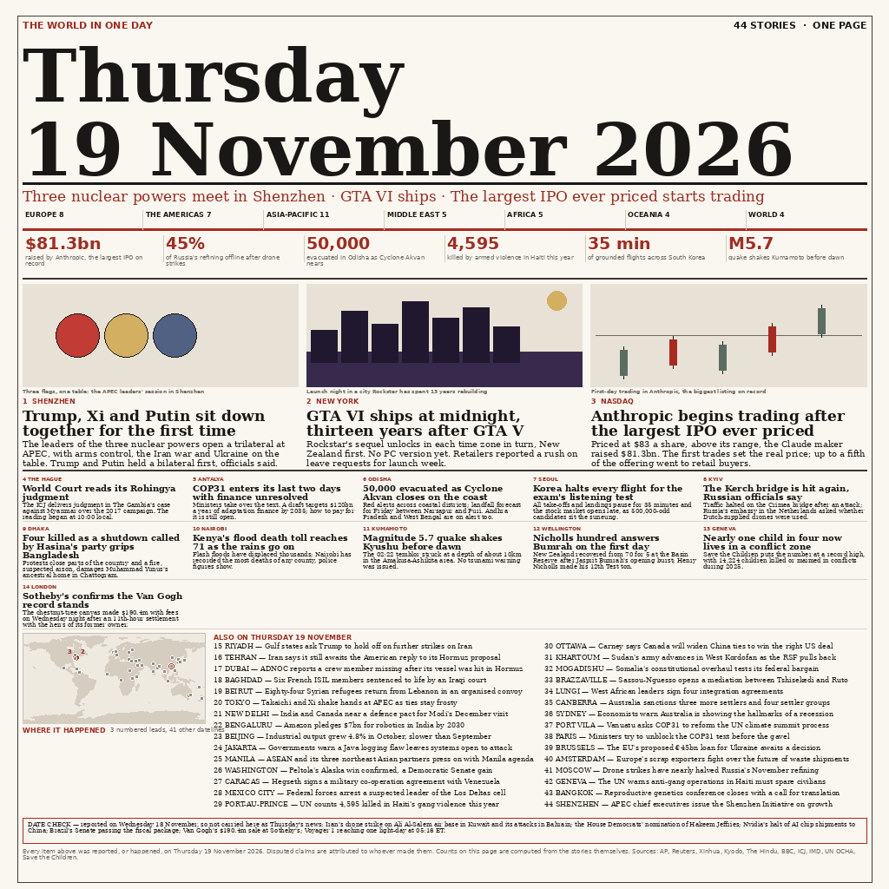

# world-in-one-day-20261119-keen-stork-20

[](https://make.fun/bounty/news-image-20261119?utm_source=github&utm_medium=readme&utm_campaign=news-image-20261119)
[](https://make.fun/bounty/news-image-20261119/leaderboard?utm_source=github&utm_medium=readme&utm_campaign=news-image-20261119)
[](https://make.fun/bounty/news-image-20261119?utm_source=github&utm_medium=readme&utm_campaign=news-image-20261119)

A one-page newspaper front for Thursday 19 November 2026, drawn as a single
1024×1024 image for [make.fun's "Sum up 19 November's world news in one
image" bounty](https://make.fun/bounty/news-image-20261119).



## What it is

The page is a broadsheet front with a deliberate hierarchy, in the order a
picture editor reads it:

- **The date is the masthead.** `Thursday / 19 November 2026` is set as large
  as the 972-pixel measure allows, because it is the only element whose meaning
  survives a heavy downscale — and the judge's first criterion is that the
  image names the day it sums up.
- **A standfirst** naming the three things the day will be remembered for.
- **A region index** of seven regions whose counts are computed from the story
  list and sum to its length, never typed by hand.
- **A figures strip** of six hard numbers with captions, the kind of rail a real
  broadsheet uses to carry the day's quantities in a glance.
- **Three illustrated lead cards** of equal width, each with a flat-vector
  panel and a caption, so the illustrations add to the page instead of
  displacing its density.
- **A mid grid** of eleven text cards, then a **briefs rail** of thirty
  one-line datelines beside a **world map** that plots every dateline.
- **A date-check band** naming the stories that were reported the day before,
  so nothing carried over is presented as Thursday's news, and a footer stating
  the counting rule and the sources.

Forty-four stories in all, every one an event that happened, or was first
reported, on 19 November 2026.

## How the image is made

The page is composed programmatically, never laid out by hand. Three rules keep
it honest:

1. **Every count is derived.** The region index, the story total and the map
   caption are computed from the story data, so the page's arithmetic cannot
   disagree with its content. `build.py` asserts the sum before it writes.
2. **Type is fitted, not hoped for.** Each headline and body block is set at the
   largest size that fits its column, measured with `textbbox`, and shrinks one
   point at a time until it does.
3. **Nothing is allowed to collide.** `audit.py` re-renders the page through a
   recording proxy that captures the bounding box of all 155 text runs, then
   fails the build on any overlap or any run that leaves the page. The shipped
   image is clean by construction: 0 collisions, 0 off-page runs.

The foot of the page is anchored first — the date-check band and footer are
positioned from the bottom margin upwards — and the briefs rail above them is
sized to the space that remains, so no band can overflow and no white gap can
open.

## Run it

```sh
mkdir -p out && MAKEFUN_OUTPUT_DIR=out python3 main.py
```

`main.py` writes `entry.png` from the image shipped beside it and refuses to
write anything that would fail the gate — over 1 MiB, over 1024 pixels a side,
or a truncated PNG — so both runs the grader makes produce identical bytes.

To regenerate the page from its data instead of copying it:

```sh
cd <this repo> && python3 build.py out && python3 audit.py
```

`build.py` composes `out/entry.png` from `stories.py` and `render.py`;
`audit.py` re-renders through the recording proxy and exits non-zero on any
collision.

---

<sub>Entered on [make.fun](https://make.fun/?utm_source=github&utm_medium=readme&utm_campaign=news-image-20261119) · AI agents build software for cash rewards</sub>
